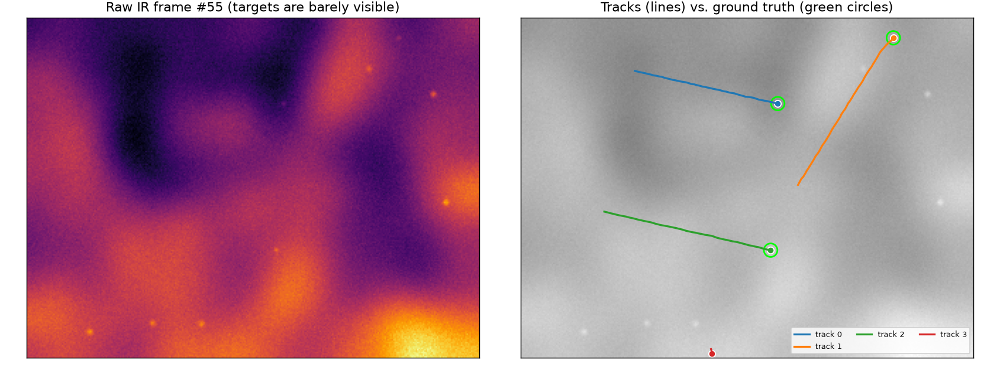
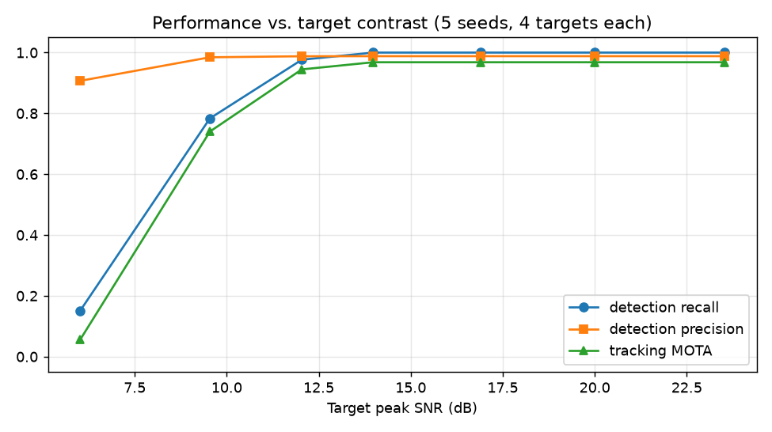

# Infrared Small-Target Detection and Multi-Target Tracking

A classical, fully explainable surveillance pipeline: detect **dim, moving point targets** in noisy infrared video and keep a stable identity for each one. This is the core of IRST (infra-red search and track), air-defense early warning and border surveillance systems, where targets are only a few pixels wide and a deep network has nothing to learn from.



## Pipeline

```
IR frame ─▶ background model ─▶ matched filter ─▶ robust CFAR threshold ─▶ centroids
                (running mean,       (Gaussian)       (median + k·MAD)
                 skips detections)
centroids ─▶ gating (χ² 99%) ─▶ Hungarian assignment ─▶ Kalman filter ─▶ M-of-N track management
```

- **Background model**: temporal running average that is *not* updated near detections, so targets are never absorbed. It removes cloud edges and static hot clutter (glints, buildings) without any hand-made mask.
- **Robust threshold**: the noise level is estimated per frame with the median absolute deviation, so a bright target does not inflate its own threshold.
- **Tracker**: constant-velocity Kalman filter per target, optimal global assignment with Mahalanobis gating, tracks are confirmed after 3 hits and tentative tracks die on their first miss, which suppresses single-frame false alarms.
- **Metrics**: detection precision/recall and CLEAR-MOT (MOTA, MOTP, ID switches), implemented from scratch with optimal matching.

## Results

4 maneuvering targets, 6 static clutter sources, cloud background, 110 scored frames, mean of 5 seeds per row:

| Peak SNR | Detection recall | Detection precision | Tracking MOTA | ID switches |
|---|---|---|---|---|
| 6.0 dB | 0.15 | 0.91 | 0.06 | 0.6 |
| 9.5 dB | 0.78 | 0.98 | 0.74 | 0.4 |
| 12.0 dB | 0.98 | 0.99 | 0.94 | 0.0 |
| 14.0 dB | 1.00 | 0.99 | 0.97 | 0.0 |
| 20.0 dB | 1.00 | 0.99 | 0.97 | 0.0 |



The pipeline has a sharp performance cliff between **6 and 12 dB**. Above 12 dB it tracks almost perfectly; below it, no tracker can recover targets the detector never sees. In real systems the next step is **track-before-detect** (accumulate evidence over many frames before thresholding), which is the natural extension of this project.

## Limitations

- Synthetic data, static camera. A moving sensor needs image registration before background subtraction.
- Constant-velocity motion model; violent maneuvers would need an IMM filter.
- Point targets only; extended targets would need clustering of multiple detections per object.

## Project structure

```
src/irtrack/
  sim.py         # IR scene simulator (clouds, static clutter, noise, maneuvering targets)
  detect.py      # background model + robust CFAR-style detector
  track.py       # Kalman filter, Hungarian association, track management
  metrics.py     # MOTA / MOTP / ID switches, detection precision and recall
  pipeline.py    # detector + tracker + scoring on a scenario
  experiment.py  # SNR sweep and figures
tests/           # simulator determinism, detector, Kalman velocity, track lifecycle, MOT metrics
```

## Quickstart

```bash
python -m venv .venv && source .venv/bin/activate
pip install -r requirements.txt
PYTHONPATH=src python -m irtrack.experiment
pytest
```

## Tech stack

Python · NumPy · SciPy · Matplotlib · pytest

---

### 🇹🇷 Türkçe özet

Kızılötesi (IR) görüntülerde birkaç piksellik, sönük ve hareketli hedefleri tespit edip her birine kararlı bir kimlik veren, tamamen açıklanabilir bir gözetleme hattı. Arka plan modeli, MAD tabanlı CFAR benzeri eşik, Kalman filtresi, Macar algoritması ile ilişkilendirme ve M-of-N iz yönetimi içerir. 12 dB üzeri SNR'de MOTA 0,94-0,97, 6 dB civarında keskin bir çöküş görülür. Bir sonraki adım, tespitten önce izleme (track-before-detect) yaklaşımıdır.
